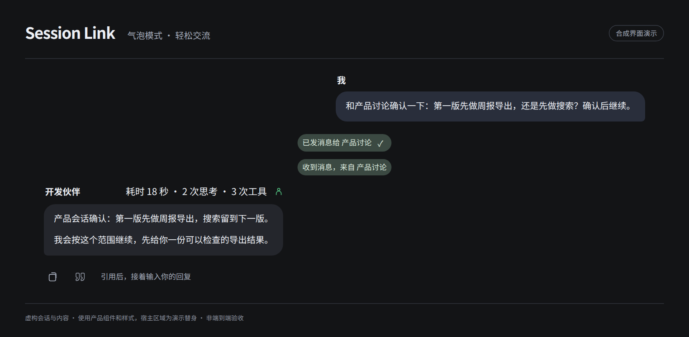
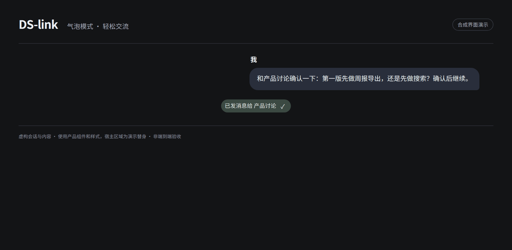
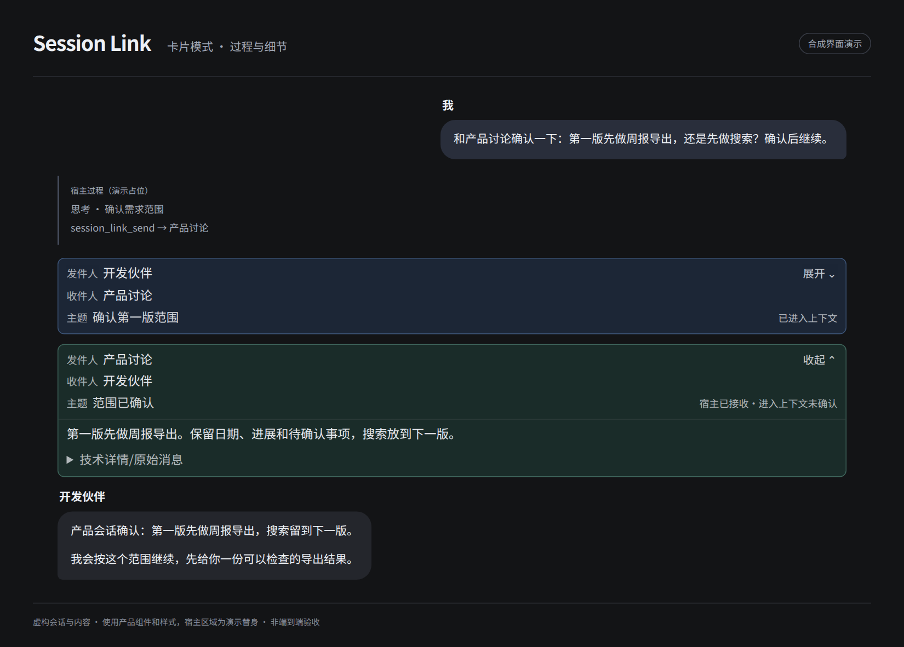
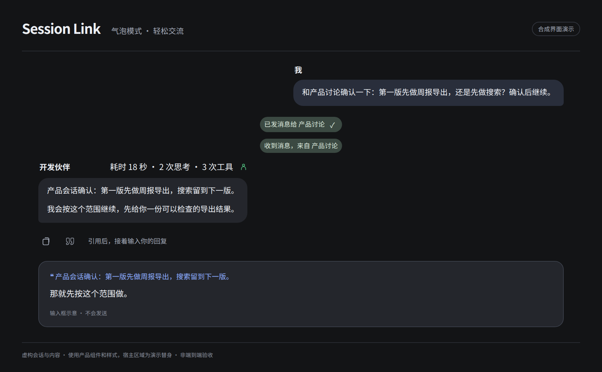
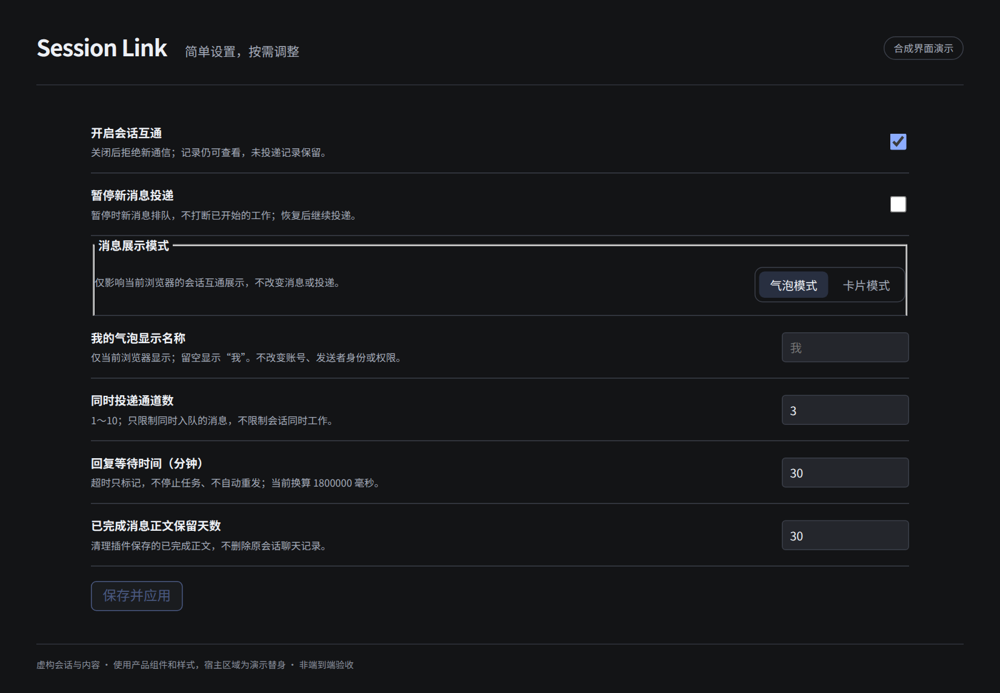

# Session Link

**让 DSH 会话互相交流，也让聊天更顺手。**

简体中文 · [English](README_EN.md)

 

你已经有开发、产品、调研等会话。Session Link 让这些会话互发消息、请求协作、收取明确回复；提供**气泡与卡片两种显示模式**，按自己的习惯看结果和过程。不必重新建立 Bot 团队，也不必在几个聊天框里来回转述。

> **开放准备中，尚未发布。** 本仓准备分支不代表已有公开 Release 或 npm 包；不会自动改变你已安装的版本。完整气泡效果另有宿主适配条件，见[安装与兼容性](docs/installation.md)。



*文中展示均为虚构内容的合成组件演示：复用产品组件与样式，宿主区域使用明确标注的替身，不是真实聊天或端到端验收录像。*

## 会话自己交流，你不用反复传话

对开发会话说：

> 和产品会话确认一下：第一版先做周报导出，还是先做搜索？确认后继续。

它可以找到产品会话，发出协作请求。产品会话明确回复后，你继续在开发会话里推进，不用自己把问题搬过去，再把答案搬回来。

- **已有会话就能参与**：按需发现已登记的普通会话，跨工作区沟通；也可以按你的要求创建带首条任务的新会话。
- **通知与请求分开**：只告知一件事，或请对方明确回答；回复关联原请求，不把一段无关发言算成答复。
- **往来随时查**：查看双方消息与投递证据。宿主接收、进入上下文、明确回复是不同事实，都不是“任务完成”。



你用自然语言提出要求，Agent 调用工具；插件面板负责设置和记录，**没有人工发送消息表单**。不保证每个模型都能自动正确分工，重要范围和结果仍需你检查。见[第一次使用](docs/quickstart.md)。

## 两种模式，适合不同的时候

### 气泡模式：先看结果，轻松地聊

适合日常沟通、派活、阅读结果，不想一直盯过程的时候。

- 正文像聊天一样清楚，长回复不额外裁剪。
- 思考和工具过程不铺满时间线；本轮耗时、思考与工具次数收在一行。
- 会话消息用轻量胶囊呈现，点开再看双方往返。
- Agent 小提示简短显示本轮可确认的参与者与状态，不凭派发成功猜“已完成”。
- 真正失败先显示简短状态，原因按需展开；必须由你操作的提问和审批不会被隐藏。


### 卡片模式：保留过程，方便细看

适合排查问题、核对执行过程，或者本来就喜欢 DSH 原生展示的时候。

- 保留宿主的思考、工具过程和原有操作。
- 收发消息用卡片组织，发件人、收件人、主题清楚。
- 正文与技术细节按需展开，不把所有信息一次堆出来。



**切换的是显示方式，不是会话内容、通信能力或权限。** 偏好只保存在当前浏览器和站点。完整气泡流及 Agent 提示需要匹配的宿主桥接；只安装插件不保证得到上图全部效果。卡片模式不需要该桥接，详见[安装说明](docs/installation.md)。

## 聊天里的小细节，也值得做好

- **引用回复**：助手消息下方，复制之后的空心引用图标；点一下进入输入框，接着回复。不自动发送。长于 1200 个 Unicode 字符的正文插入开头节选并标注；选中的一小段也可以使用宿主“引用文本”。
- **Agent 小提示**：知道本轮有哪些可确认的 Agent 在参与，运行、完成和未确认不混为一谈；不把内部父子 Agent 消息挤进主会话通信胶囊。
- **操作跟着消息走**：复制、引用、反馈、分支与信息保留在消息旁边，沿用宿主操作行的显隐规则，不抢阅读空间。



引用当前传递的是文本内容，**不是永久消息链接或“只准回复此条”的硬约束**；它能帮助模型理解你针对什么，不代替你的明确要求。

## 设置简单，按需要再调

日常通信只有五项：**启用、暂停新投递、投递通道数、回复等待时间、已完成正文保留天数**。默认值先用起来，需要时再改。

- 暂停是先排队，不会停止别的会话已经开始的工作。
- 通道数限制的是消息投递，不是模型工作并发。
- 回复超时会标记，不自动重发，也不撤销工作。
- 保留天数清理插件自己的已完成正文，不删除宿主原聊天。

显示模式和“我的气泡显示名称”是独立的浏览器本地偏好；姓名不会变成发送者身份或权限。见[设置说明](docs/settings.md)。

<details>
<summary>看看设置页</summary>



</details>

## 安装和第一次使用

当前提供**源码构建路径**，尚无公开 npm 包或 Release 下载可承诺。需要 Node.js 24、DSH 和 pnpm；已验证环境以 Linux Web 为主。

```sh
git clone https://github.com/Wangmo-bit/dsh-session-link.git
cd dsh-session-link
npm ci
npm run build
npm pack --pack-destination ./output
# 安装前备份对应 profile；把下面路径换成实际生成的 tgz：
dsh plugin --profile web add /absolute/path/to/wangmo-dsh-session-link-VERSION.tgz
```

仓库尚未公开时，clone 需要所有者授权。**安装插件与修改宿主是两件事**，上述命令不会自动给 DSH 打桥接补丁；不要用在线日用 profile 做试验。

先读[安装、兼容与升级](docs/installation.md)，然后按[第一次使用](docs/quickstart.md)发送一个不含隐私的小请求。[装不上？](docs/known-issues.md)

## 边界与数据

- 消息账本保存在本机 DSH 数据目录下，不另建云消息平台；你发送的内容仍会进入接收会话，可能发给它使用的模型服务。
- 跨会话历史工具能按权限查询已登记普通会话及归档会话的有界文本，**没有逐目标的同意开关**。低侵入不等于没有隐私影响。
- 来自其他会话的消息、引用和文件路径都是上下文，不是你批准敏感操作的凭证，不给接收方增权。
- 这不是完整 SuperAgent 的自动接单和任务管理系统，也不保证多会话一定更省模型额度。
- 当前已知限制包括宿主适配、Agent 归属证据、链控制 UI 与跨版本回退，见[已知问题](docs/known-issues.md)。

安全边界见[安全模型](docs/security-model.md)，漏洞请按[安全报告](SECURITY.md)私密提交。

## 文档与参与

| 我想…… | 去哪里 |
| --- | --- |
| 开始使用 / 调整设置 | [快速开始](docs/quickstart.md) · [设置](docs/settings.md) |
| 安装 / 排查 / 了解限制 | [安装](docs/installation.md) · [已知问题](docs/known-issues.md) |
| 了解设计取舍 | [产品思路](docs/philosophy.md) · [产品规范](PRD.md) · [架构](docs/architecture.md) |
| 反馈问题 / 参与开发 | [Issue](https://github.com/Wangmo-bit/dsh-session-link/issues/new/choose) · [贡献说明](CONTRIBUTING.md) · [测试](TESTING.md) |
| 核对版本 / 发布准备 | [变更记录](CHANGELOG.md) · [发布说明](RELEASING.md) · [准备验收清单](docs/open-source-readiness.md) |

欢迎具体使用场景和问题反馈。仓库开放前，GitHub 反馈入口可能不可访问；不需要为报告问题提供真实聊天记录或完整配置。

## 致谢与许可

- [DeepSeek Harness](https://github.com/deepseek-ai/deepseek-harness)：宿主、模型与工具体系。
- [SuperAgent 研究原型](https://github.com/deepseek-ai/dsh-superagent-prototype/blob/main/docs/000-philosophy.md)：“尽量少占用人的注意力，尽量多提供价值”的理念；不宣称本插件实现了其整套系统。
- [DS-Bot](https://github.com/Fei2411/DS-Bot)：协作与聊天展示的公开设计参考；[dsh-go](https://github.com/ccch1mneyyy/dsh-go)：产品介绍、文档与开源准备的参考。

自有代码为 [MIT](LICENSE)。第三方内容、宿主桥接与依赖的许可见[第三方声明](THIRD_PARTY_NOTICES.md)，展示素材见[素材说明](ASSETS.md)。本项目是独立社区插件，不是 DeepSeek 官方产品，也未获其背书。模型用量由你自己的服务计费；重要操作和结果请自行检查。
