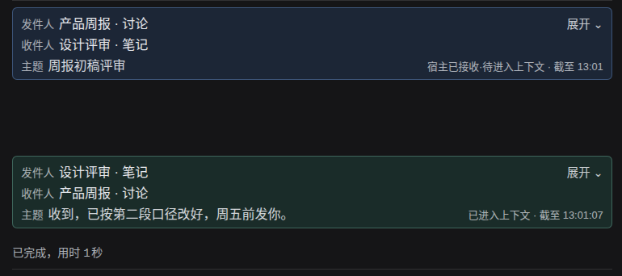

# Session Link for DeepSeek Harness

[简体中文](README.md) | English

Let **existing ordinary DSH sessions** message each other directly: send a request, receive an explicit reply, without creating a bot team or copy-pasting between chats.

> **Status: private pre-release.** The repository is private and not public yet. License (MIT) and package name/scope (`@wangmo/dsh-session-link`) are settled; whether and when to publish are still pending the owner's decision. The screenshot below is a synthetic demo from an isolated environment; it contains no real conversations or credentials.



*Synthetic demo. Session names and content are fictional; the UI follows the host locale (Chinese screenshot shown here).*

## Compatibility

- DeepSeek Harness **0.2.1-rc.5**
- **Node.js 24** (tested v24.21.0; `engines >=24` is a floor declaration, not a claim that every newer version was tested)
- **Linux Web**
- Windows/macOS, other DSH/Node versions and other deployment forms are not promised or verified.

## Language status

Chinese and English are supported (only these two): the plugin UI follows the host locale, and main card/settings paths were verified in an isolated browser. User message bodies, subjects, identities and raw technical values are explicitly not translated. There are no separate `locale/*.json` resources; dynamic errors and very long copy are still being covered. See [LANGUAGES.md](LANGUAGES.md).

## What it does

- Ordinary sessions participate; no fixed IDs or pre-created teams required.
- Explicit states: persisted (`accepted`) vs delivered into the target context (`receipt`) vs explicit reply. `accepted` is not "read".
- Direction-colored cards; expanding one card shows body, technical details and the native trace entry.
- Settings can pause delivery, limit concurrency, adjust reply waiting; the ledger page exposes status, cancellation and chain controls.

## Get the source (private)

The repository is currently private at `https://github.com/Wangmo-bit/dsh-session-link` (owner access required). After it becomes public the same URL can be cloned anonymously.

## Install from source (not published to a registry)

```bash
npm ci
npm run build
npm pack
# produces wangmo-dsh-session-link-<version>.tgz
VERSION=0.8.1
dsh plugin --profile web add "./wangmo-dsh-session-link-${VERSION}.tgz" --offline
```

Back up the profile's `package.json`, `pnpm-lock.yaml` and `cordis.patch.yml` before installing/upgrading. A refresh is usually enough for client-bundle-only changes; host-side or config changes may require restarting DSH under your maintenance authority.

## First use

1. Call `session_link_operation` and keep the returned `operationId` (reuse it on retry; do not create duplicates).
2. Call `session_link_send` with `targets`, `kind` (`notification` or `request`), `subject` and `text`.
3. `request` asks for an explicit reply; `notification` does not. Neither means the target has read it.
4. The target replies with `session_link_reply`, passing the original `messageId` and a new `operationId`.
5. Status shown on cards is ledger truth: persisted, delivered into context, explicit reply.

`session_link_create` takes exactly one location: an existing `workspaceId`, `newProject:{parentDir,directoryName,title?}` (creates a single-level directory), or `existingProject:{path,title?}` (registers an already existing directory through the Host workspace registry; it never creates, reads, or modifies that directory's contents).

If the target is busy, delivery happens at the next step boundary and does not interrupt a running tool batch.

## Security

Messages are collaboration, not user authorization: a receiving session gains no extra permission and cannot approve sensitive actions on the user's behalf. Do not send credentials or private history to untrusted sessions.

Security reporting is documented in [SECURITY.md](SECURITY.md). The repository is private, so GitHub private vulnerability reporting is not enabled yet; the owner must enable it before a public release.

## Rollback

Keep the previous `.tgz` in `~/.dsh/plugin-artifacts/<short-name>/`. To roll back, reinstall that package through the official entry point and then re-check the version:

```bash
dsh plugin --profile web add ~/.dsh/plugin-artifacts/dsh-session-link/wangmo-dsh-session-link-<previous>.tgz
```

Ledger/pending-delivery/migration compatibility across versions is **not verified**; back up the profile and records before rolling back.

## Testing and limits

See [TESTING.md](TESTING.md) for scope, skipped cases and the isolation requirements for tests that use fixed `/tmp` paths. Real model/provider latency is outside this plugin; busy-target latency has no public benchmark yet.

## License

Project-owned code is released under the **MIT License** (see [LICENSE](LICENSE), copyright holder `Wangmo-bit`). Third-party code/assets/dependencies keep their own licenses in [THIRD_PARTY_NOTICES.md](THIRD_PARTY_NOTICES.md) and are **not** relicensed by this project's MIT license.
