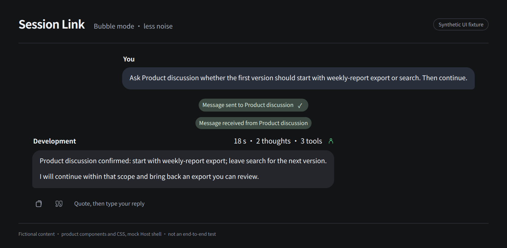
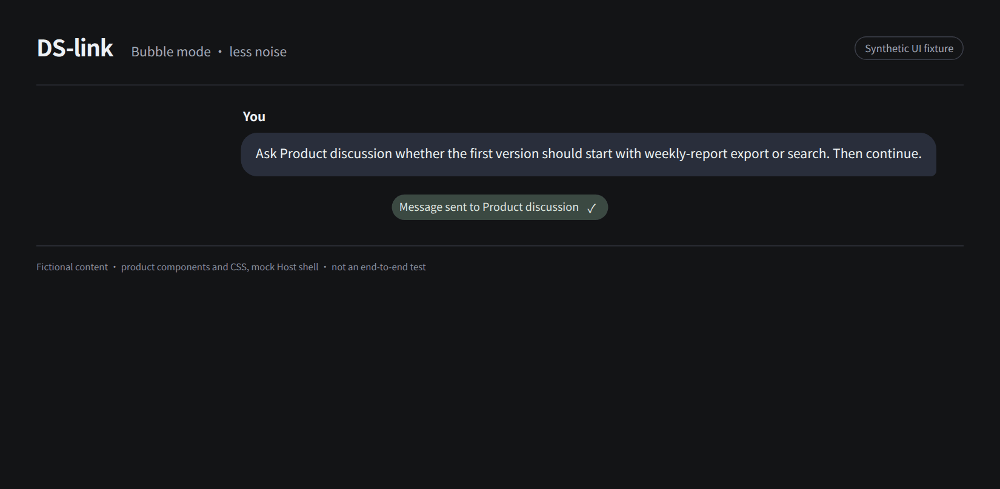
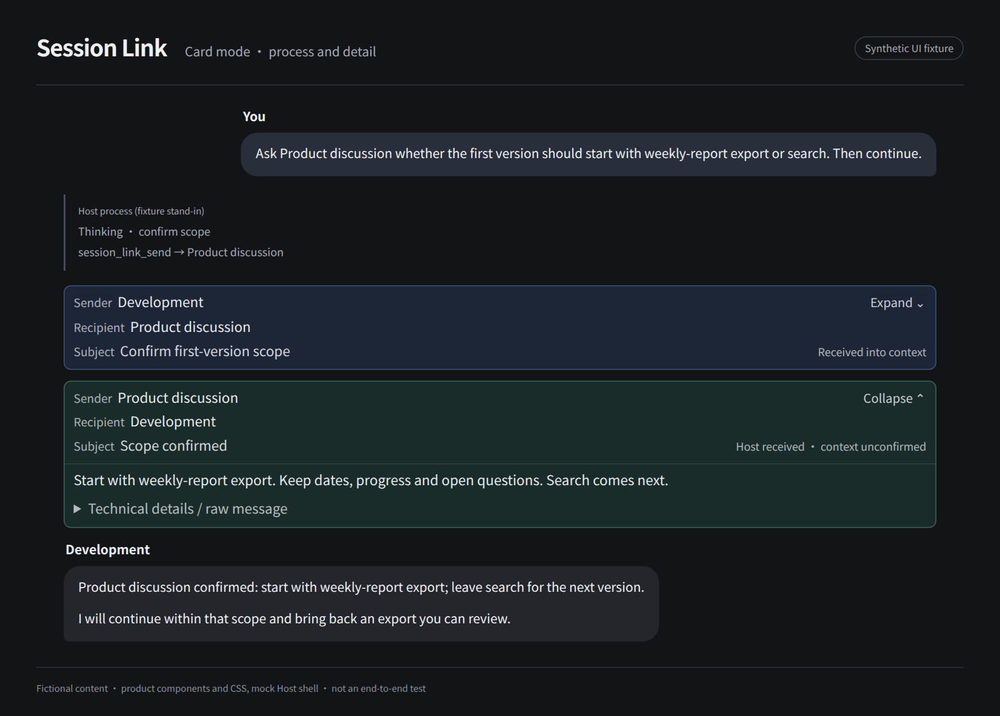
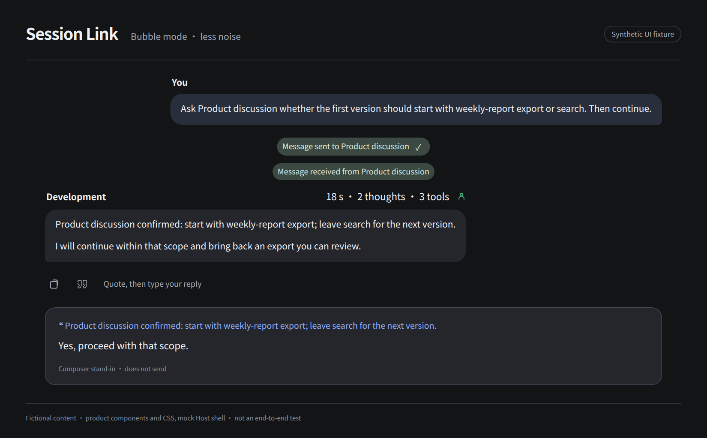
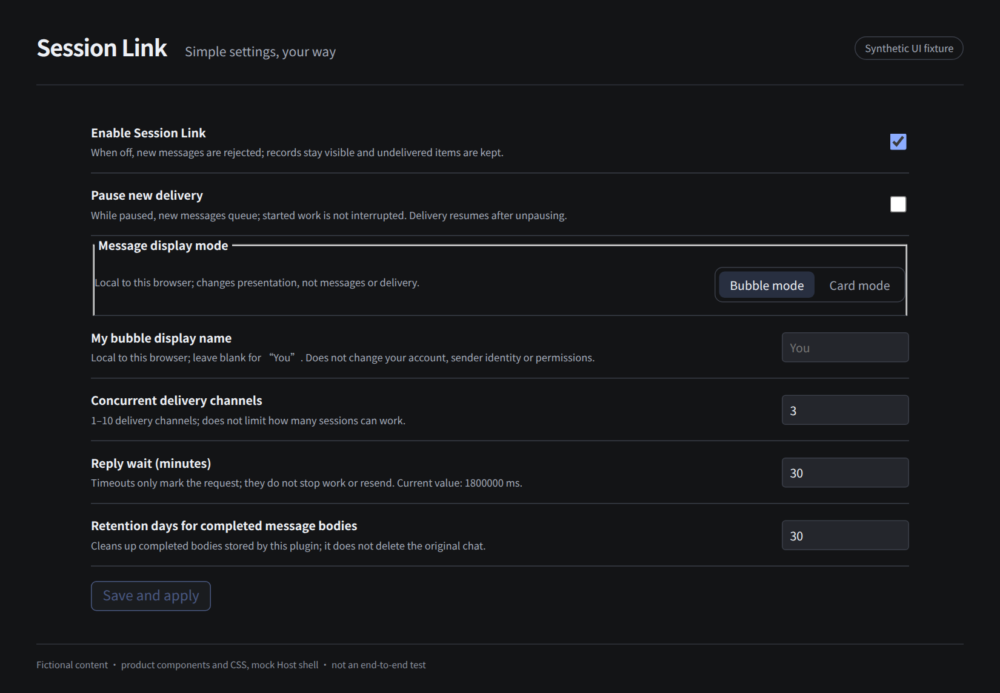

# Session Link

**Let DSH sessions talk to each other. Make everyday chat easier.**

[简体中文](README.md) · English

 

You already have development, product and research sessions. Session Link lets those sessions exchange messages, ask for help and receive explicit replies. Choose **bubble or card mode** to read results and inspect work your way. No new bot team, and less copying between chat windows.

> **Preparing for open source; not released yet.** This preparation branch does not imply a public Release or npm package and does not update your installed plugin. Full bubble behavior has a separate Host adaptation requirement; read [installation and compatibility](docs/installation.en.md).



*All images use fictional content and product components/CSS in a labelled synthetic fixture. Host areas are mock stand-ins, not real conversations or end-to-end validation recordings.*

## Let sessions exchange the question and answer

Tell your development session:

> Ask Product discussion whether the first version should start with weekly-report export or search. Then continue.

It can find the product session and send a request. After an explicit reply, continue in the development session instead of carrying the question and answer between windows yourself.

- **Use existing sessions:** discover registered ordinary sessions across workspaces, or ask to create a new session with its first task.
- **Separate notifications from requests:** tell another session something, or ask it for a reply explicitly linked to your request.
- **Inspect the exchange:** look at messages and delivery evidence. Host acceptance, context receipt and an explicit reply are different facts; none proves the work is done.



You ask in natural language and the Agent calls tools. The panel holds settings and records, **not a manual message-sending form**. A model may still misunderstand scope or fail to coordinate; review important results. See [first use](docs/quickstart.en.md).

## Two modes, for different moments

### Bubble mode: read the result, without the noise

For everyday conversation, delegation and reading results when you do not want to watch every execution step.

- Clear message bodies; long replies are not additionally clipped.
- Reasoning and tool bodies stay out of the timeline; elapsed time and thought/tool counts occupy one line.
- Lightweight message capsules open the exchange on demand.
- Small Agent hints show participants and states only when the evidence supports them; dispatch is not completion.
- A failed turn has a short status and expandable cause. Questions and approvals requiring you remain available.


### Card mode: keep the process and inspect the details

For troubleshooting, checking execution, or simply preferring DSH's original process view.

- Keeps native reasoning, tool steps and existing actions.
- Groups sent and received messages in cards with sender, recipient and subject.
- Expands bodies and technical details when you need them.



**Switch presentation, not messages, collaboration rights or permissions.** The preference is local to this browser and origin. Full bubble flow and per-turn Agent hints require the matching Host bridge; the plugin alone does not guarantee every behavior shown above. Card mode needs no bridge. See [installation](docs/installation.en.md).

## Small interactions matter too

- **Quote a reply:** the outline quote icon follows Copy in an assistant message's action strip. Click, then type your response. Nothing is sent automatically. Bodies longer than 1,200 Unicode code points use a marked opening excerpt; for a smaller selection, use the Host's selected-text quote action.
- **Agent hints:** see participants and evidence-backed states without turning internal parent/child messages into peer-session capsules.
- **Actions stay with the message:** copy, quote, feedback, branch and info follow the Host action strip's reveal rules instead of crowding the reading area.



Quotes carry text, **not a permanent source-message link or a hard instruction to answer only that message**. They help the model understand your reference; your own instructions still matter.

## Simple settings, adjustable when you need them

Five shared communication settings: **enabled, pause new delivery, delivery channels, reply wait and completed-body retention**. Start with defaults and adjust when necessary.

- Pause queues new delivery; it does not stop work already running in another session.
- Channels limit delivery, not the number of models working.
- Timeouts mark requests; they do not resend or cancel the work.
- Retention cleans the plugin's completed bodies, not original Host chats.

Display mode and your bubble display name are separate browser-local preferences. A name changes neither sender identity nor permissions. See [settings](docs/settings.en.md).

<details>
<summary>See the settings</summary>



</details>

## Install and start

The currently available path is **build from source**; no public npm package or Release download is promised yet. Requires Node.js 24, DSH and pnpm; verified environments are primarily Linux Web.

```sh
git clone https://github.com/Wangmo-bit/dsh-session-link.git
cd dsh-session-link
npm ci
npm run build
npm pack --pack-destination ./output
# Back up the selected profile first; use the actual generated tgz path:
dsh plugin --profile web add /absolute/path/to/wangmo-dsh-session-link-VERSION.tgz
```

Until the repository is public, cloning requires owner-granted access. **Installing the plugin and modifying the Host are separate actions.** These commands do not automatically apply the bridge. Do not experiment in a daily-use profile.

Read [installation, compatibility and upgrades](docs/installation.en.md), then send a small, non-sensitive request using [first use](docs/quickstart.en.md). [Install trouble?](docs/known-issues.en.md)

## Boundaries and data

- The ledger stays in the local DSH data directory, not a separate cloud messaging service. Sent content still enters the receiving session and may reach its model provider.
- History tools can read bounded user/assistant text from registered ordinary and archived sessions under their tool access. **There is no per-target consent switch.** Low intrusion does not mean no privacy impact.
- Messages, quotes and referenced paths are context, not user approval for sensitive operations, and grant no additional permissions.
- This is not a complete SuperAgent automatic-intake/task-management system and does not guarantee lower model usage.
- Host adaptation, Agent attribution evidence, chain-control UI and cross-version rollback have limits: [known issues](docs/known-issues.en.md).

See the [security model](docs/security-model.md) and report vulnerabilities privately using the [security policy](SECURITY.en.md).

## Documentation and participation

| I want to… | Read |
| --- | --- |
| Start or adjust settings | [First use](docs/quickstart.en.md) · [Settings](docs/settings.en.md) |
| Install or troubleshoot | [Installation](docs/installation.en.md) · [Known issues](docs/known-issues.en.md) |
| Understand the design | [Philosophy](docs/philosophy.md) · [Product contract](PRD.md) · [Architecture](docs/architecture.md) |
| Report a problem or contribute | [Issues](https://github.com/Wangmo-bit/dsh-session-link/issues/new/choose) · [Contributing](CONTRIBUTING.en.md) · [Testing](TESTING.md) |
| Check changes or release preparation | [Changelog](CHANGELOG.md) · [Releasing](RELEASING.md) · [Readiness](docs/open-source-readiness.md) |

Concrete scenarios and problem reports are welcome. GitHub issue links may be unavailable before the repository opens. You never need to provide private conversations or full configuration files to report an issue.

## Acknowledgments and license

- [DeepSeek Harness](https://github.com/deepseek-ai/deepseek-harness): the Host, models and tool ecosystem.
- [SuperAgent research prototype](https://github.com/deepseek-ai/dsh-superagent-prototype/blob/main/docs/000-philosophy.md): “Take as little human attention as possible, and give as much value as possible.” This plugin does not claim to implement its whole system.
- [DS-Bot](https://github.com/Fei2411/DS-Bot): public collaboration and chat-presentation ideas; [dsh-go](https://github.com/ccch1mneyyy/dsh-go): product presentation, documentation and open-source preparation.

Project-owned code uses [MIT](LICENSE). Third-party material, dependencies and Host-bridge licensing are documented in [notices](THIRD_PARTY_NOTICES.md); demonstration assets in [asset notes](ASSETS.md). This is an independent community plugin, not an official DeepSeek product or an endorsed SuperAgent distribution. Your providers bill model usage; check important actions and results yourself.
