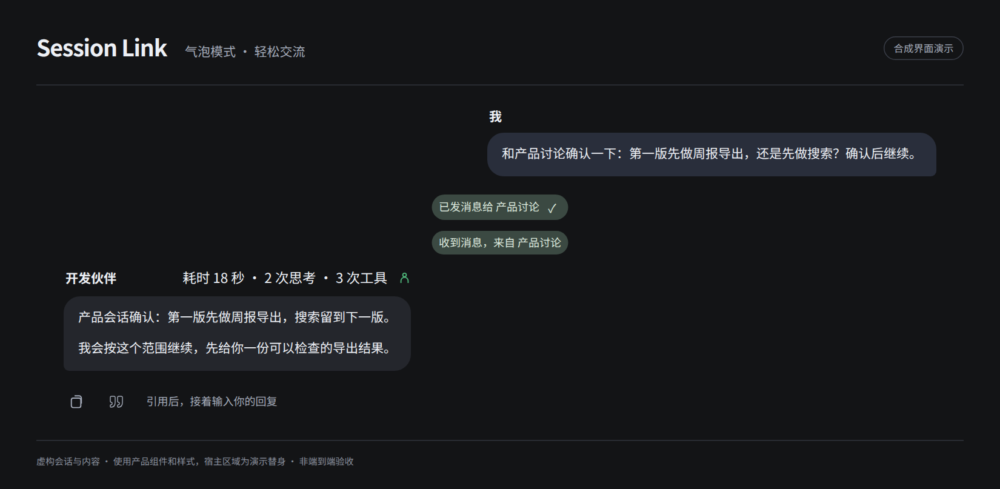
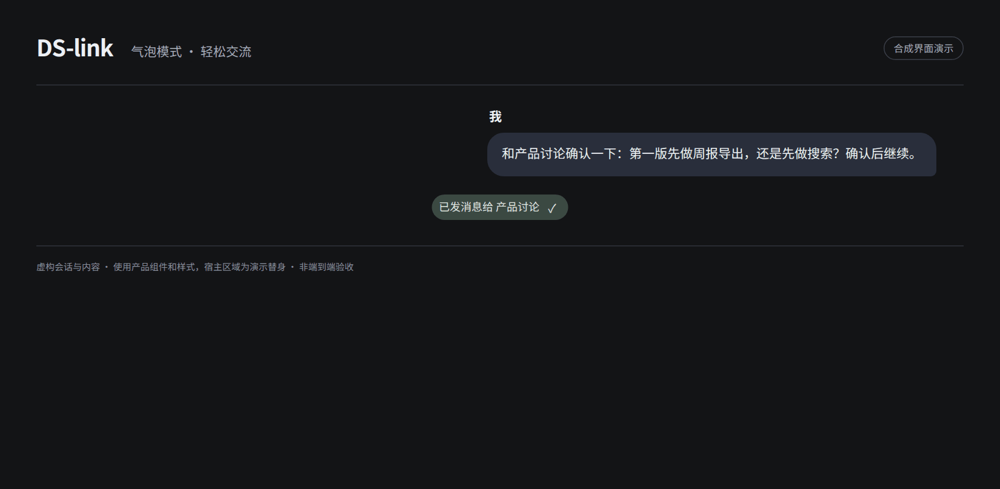
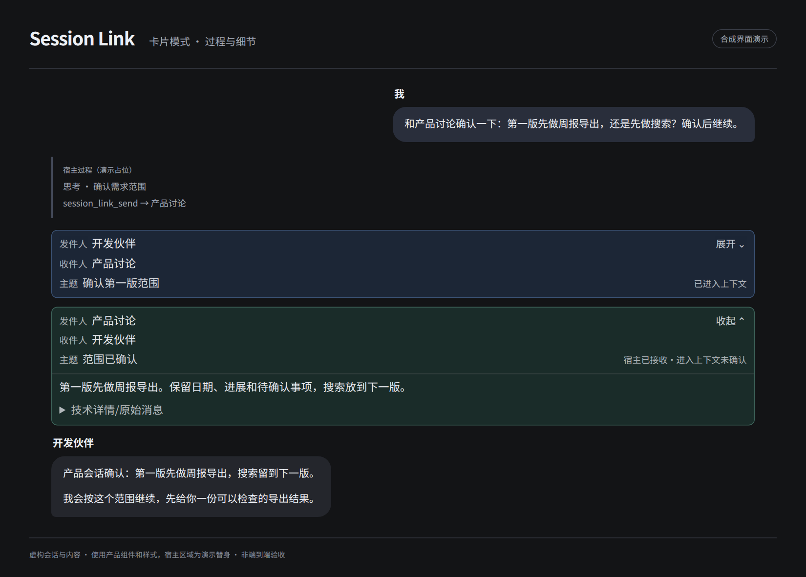
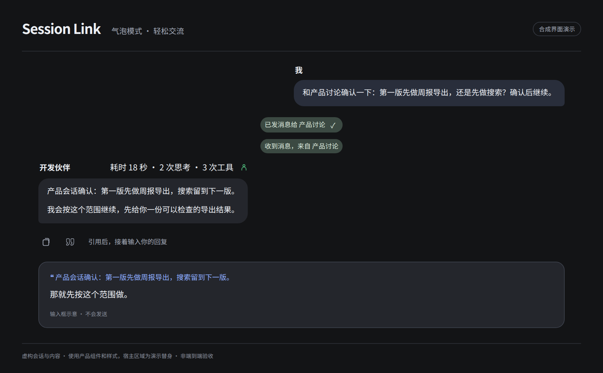
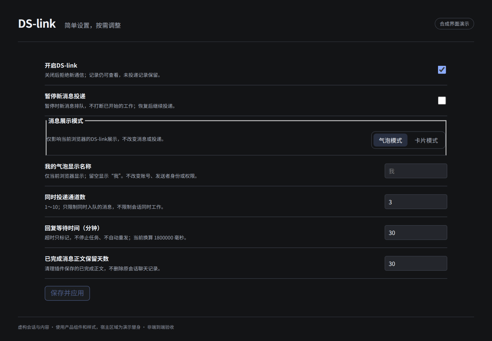

# DS-link

**让 DSH 里已有的会话互相协作。**

[English](README.md) · 简体中文

 

你已经有开发、产品、调研等会话。DS-link 让它们直接互发消息、请求协作、收取明确回复；你不用在几个聊天窗口之间来回转述，也不用另建一套 Bot 团队。

> **安装：** `dsh plugin --profile <你的profile> add @wangmo-bit/ds-link@0.8.19`。也可以从 [GitHub Release](https://github.com/Wangmo-bit/DS-link/releases/tag/v0.8.19) 下载同一个包。安装不会重启宿主，也不会自动应用可选桥接。



*演示使用虚构内容和合成界面，不是真实会话或端到端验收录像。*

## 它做什么

**DS-link 只连接同一个 DSH 宿主里已登记的会话**，可以跨工作区；不跨电脑、团队网络或公网。

对开发会话说：

> 和产品会话确认一下：第一版先做周报导出，还是先做搜索？确认后继续。

它会找到产品会话并发出协作请求。对方明确回复后，你继续在开发会话里推进，不用自己把问题搬过去、再把答案搬回来。

- **已有会话就能参与**：按需发现已登记的普通会话，跨工作区沟通；也可以按你的要求创建带首条任务的新会话。
- **通知与请求分开**：只告知一件事，或请对方明确回答；回复关联原请求，不把无关发言算成答复。
- **往来随时查**：查看双方消息与投递证据。宿主接收、进入上下文、明确回复是不同事实，都不代表“任务完成”。



你用自然语言提要求，Agent 调用工具；面板负责设置和记录，**没有人工发送消息表单**。模型仍可能理解错范围或协调失败，重要结果请自己核对。见[第一次使用](docs/quickstart.md)。

## 两种显示方式

### 气泡模式：先看结果，轻松地聊

适合日常沟通、派活、阅读结果，不想一直盯过程的时候。

- 正文像聊天一样清楚，长回复不额外裁剪。
- 思考和工具过程不铺满时间线；本轮耗时、思考与工具次数收在一行。
- 会话消息用轻量胶囊呈现，点开再看双方往返。
- Agent 小提示只显示能确认的参与者与状态，不凭派发成功猜“已完成”。
- 失败先显示简短状态，原因按需展开；必须由你操作的提问和审批不会被隐藏。

### 卡片模式：保留过程，方便细看

适合排查问题、核对执行过程，或者本来就喜欢 DSH 原生展示的时候。

- 保留宿主的思考、工具过程和原有操作。
- 收发消息用卡片组织，发件人、收件人、主题清楚。
- 正文与技术细节按需展开，不把所有信息一次堆出来。



**切换的是显示方式，不改变会话内容、通信能力或权限。** 偏好只保存在当前浏览器和站点。完整气泡流和 Agent 小提示需要匹配的宿主桥接；只安装插件不保证得到全部效果。卡片模式不需要桥接，详见[安装说明](docs/installation.md)。

## 聊天里的细节

- **引用回复**：助手消息下方，复制之后的空心引用图标；点一下进入输入框，接着回复，不自动发送。长于 1200 个 Unicode 字符的正文插入开头节选并标注；选中的一小段也可以用宿主“引用文本”。
- **Agent 小提示**：知道本轮有哪些可确认的 Agent 在参与，运行、完成和未确认不混为一谈；不把内部父子 Agent 消息挤进主会话通信胶囊。
- **操作跟着消息走**：复制、引用、反馈、分支与信息保留在消息旁边，沿用宿主操作行的显隐规则，不抢阅读空间。



引用传递的是文本内容，**不是永久消息链接或“只准回复此条”的硬约束**；它帮助模型理解你针对什么，不代替你的明确要求。

## 设置

日常通信只有五项：**启用、暂停新投递、投递通道数、回复等待时间、已完成正文保留天数**。默认值先用起来，需要时再改。

- 暂停是先排队，不会停止别的会话已经开始的工作。
- 通道数限制的是消息投递，不是模型工作并发。
- 回复超时会标记，不自动重发，也不撤销工作。
- 保留天数清理插件自己的已完成正文，不删除宿主原聊天。

显示模式和“我的气泡显示名称”是独立的浏览器本地偏好；姓名不会变成发送者身份或权限。见[设置说明](docs/settings.md)。

<details>
<summary>看看设置页</summary>



</details>

## 安装

需要 Node.js 24、DSH 和 pnpm；已验证环境以 Linux Web 为主。第一次建议用隔离 profile，并先备份目标 profile 的 `package.json`、`pnpm-lock.yaml` 和 `cordis.patch.yml`。

```sh
dsh plugin --profile <你的profile> add @wangmo-bit/ds-link@0.8.19
```

也可以从 [GitHub Release](https://github.com/Wangmo-bit/DS-link/releases/tag/v0.8.19) 下载 `.tgz` 后安装该文件，或从源码构建：

```sh
git clone https://github.com/Wangmo-bit/DS-link.git
cd DS-link
npm ci
npm run build
mkdir -p output
npm pack --pack-destination ./output
dsh plugin --profile <你的profile> add /absolute/path/to/wangmo-bit-ds-link-VERSION.tgz
```

**安装插件与修改宿主是两件事**：上述命令不会自动给 DSH 打桥接补丁，也不会重启服务。包名是 `@wangmo-bit/ds-link`；旧 `session_link_*` 工具与数据标识保留兼容，旧包升级见[安装与迁移](docs/installation.md#旧包改名迁移)。

## 边界与隐私

- 消息账本保存在本机 DSH 数据目录下，不另建云消息平台；你发送的内容仍会进入接收会话，可能发给它使用的模型服务。
- 跨会话历史工具能按权限查询已登记普通会话及归档会话的有界文本，**没有逐目标的同意开关**。低侵入不等于没有隐私影响。
- 来自其他会话的消息、引用和文件路径都是上下文，不是你批准敏感操作的凭证，不给接收方增权。
- 它不是自动接单和任务管理系统，也不保证多会话一定更省模型额度。
- 已知限制包括宿主适配、Agent 归属证据、链控制 UI 与跨版本回退，见[已知问题](docs/known-issues.md)。

安全边界见[安全模型](docs/security-model.md)，漏洞请按[安全报告](SECURITY.md)私密提交。

## 文档与反馈

| 我想…… | 去哪里 |
| --- | --- |
| 开始使用 / 调整设置 | [快速开始](docs/quickstart.md) · [设置](docs/settings.md) |
| 安装 / 排查 / 了解限制 | [安装](docs/installation.md) · [已知问题](docs/known-issues.md) |
| 了解设计取舍 | [产品思路](docs/philosophy.md) · [架构](docs/architecture.md) |
| 反馈问题 / 参与开发 | [Issue](https://github.com/Wangmo-bit/DS-link/issues/new/choose) · [贡献说明](CONTRIBUTING.md) · [测试](TESTING.md) |

欢迎具体使用场景和问题反馈；不需要提供真实聊天记录或完整配置。

## 致谢与许可

- [DS-Bot](https://github.com/Fei2411/DS-Bot)：协作与聊天展示的公开设计参考。
- [Claude](https://claude.com/)：作者最早体验到这类协作功能的产品，也是 DS-link 的早期启发来源。

自有代码为 [MIT](LICENSE)。第三方内容、宿主桥接与依赖的许可见[第三方声明](THIRD_PARTY_NOTICES.md)，展示素材见[素材说明](ASSETS.md)。本项目是独立社区插件，不是 DeepSeek 官方产品，也未获其背书。模型用量由你自己的服务计费；重要操作和结果请自行检查。
