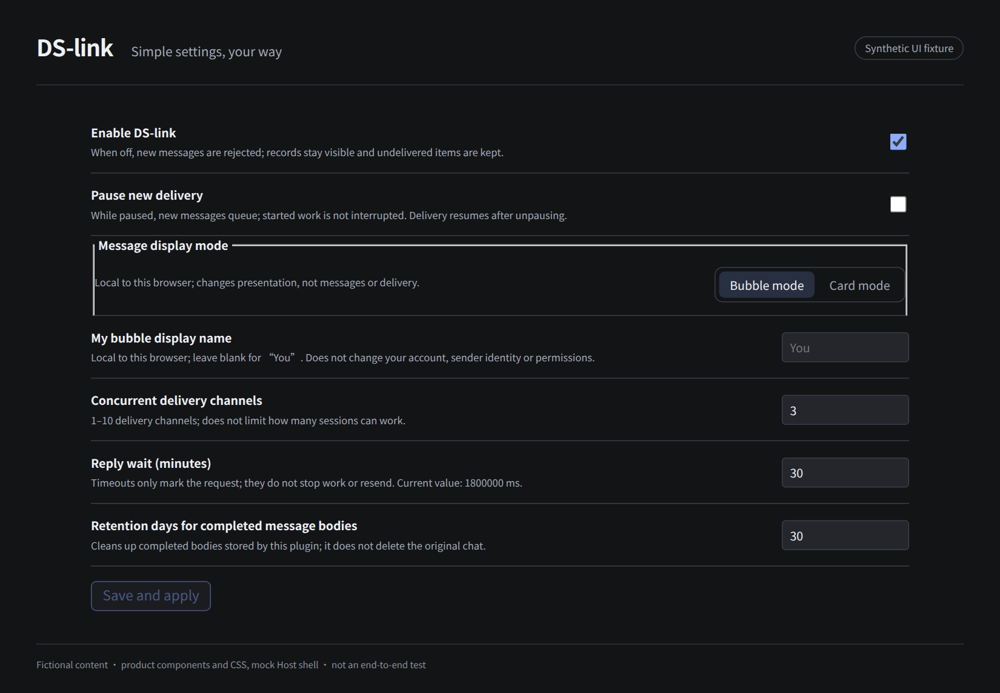

# Settings: start with defaults

[简体中文](settings.md) · [Home](../README.md)

Open DS-link in the sidebar, then Settings. There is no manual send form.

| Setting | Default | Effect |
| --- | --- | --- |
| Enabled | On | Off rejects new collaboration; records remain. It does not stop all Agents |
| Pause new delivery | Off | Holds newly accepted messages until resumed; does not undo work already started |
| Delivery channels | 3 | 1–10; limits message delivery, not model execution concurrency |
| Reply wait | 30 minutes | New-style requests start counting after confirmed target-context receipt; timeout marks but does not resend or cancel |
| Completed-body retention | 30 days | Cleans completed plugin bodies, not original Host chats |

Shared settings use revision-checked saves. Concurrent changes produce a conflict instead of being silently overwritten.

## Local to this browser

- **Bubble / card:** presentation only, not protocol, messages, rights or records. Full bubble flow requires the [matching Host adaptation](installation.en.md).
- **My bubble display name:** defaults to “You” in English (a neutral label), with a custom name up to 40 Unicode code points. This is a visual label, not account or sender identity. Existing personal preferences can be entered here rather than hard-coded into public source.

These preferences live in this browser and site storage, not a shared account profile. They do not automatically sync to other devices. Blocked storage is reported as a failed save.

## Records

Inspect status, related replies and exchanges, cancel eligible undelivered messages, release legacy held entries and verify unknown outcomes. There are currently no per-chain pause/resume/close buttons; global delivery pause is not a substitute for resuming a paused chain. See [known issues](known-issues.en.md).

