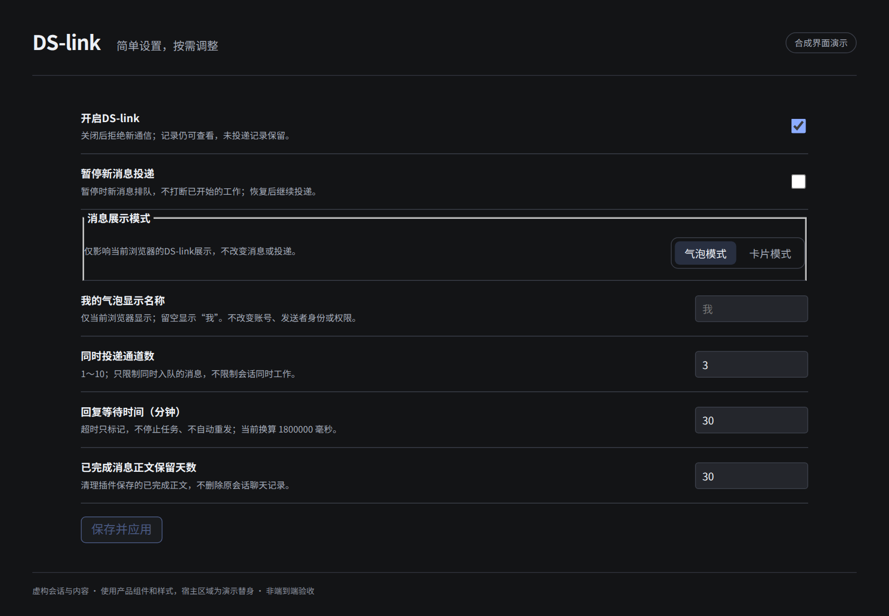

# 设置：先用默认值，需要时再调

[English](settings.en.md) · [首页](../README.md)

从左侧“DS-link”进入，打开“设置”。这里没有人工发消息表单。

| 设置 | 默认 | 改了会怎样 |
| --- | --- | --- |
| 开启DS-link | 开启 | 关闭后拒绝新通信，已有记录仍能查；不是停止所有 Agent |
| 暂停新消息投递 | 不暂停 | 接收后排队，恢复后继续；不撤销已经开始的工作 |
| 同时投递通道数 | 3 | 可选 1–10；限制投递，不限制模型同时工作 |
| 回复等待时间 | 30 分钟 | 新式请求从确认进入目标上下文后计时；超时只标记，不自动重发或取消 |
| 已完成正文保留天数 | 30 天 | 清理插件记录中的已完成正文，不删除原会话聊天 |

共享设置保存时有版本校验；其他页面改了设置时会提示冲突，不用旧草稿覆盖。

## 只影响这个浏览器

- **气泡 / 卡片**：切换展示，不变更协议、消息、权限或记录。完整气泡流依赖[匹配的宿主适配](installation.md)。
- **我的气泡显示名称**：默认“我”，可写自己的称呼（40 个 Unicode 字符以内）。这是外观标签，不是账号或发件身份。以前自用的姓名不再写死在公共代码中；如需保持原称呼，在这里设置即可。

这两项保存在当前站点的浏览器本地存储，不随另一个浏览器或设备自动同步。浏览器禁止站点存储时会报告保存失败。

## 通信记录

记录页可看状态、关联回复和往返，处理既有未投递取消、旧暂存释放与 unknown 核对。链的暂停/恢复/关闭目前没有对应 UI 按钮；不要把“暂停所有新投递”当成“恢复某条暂停链”。见[已知问题](known-issues.md)。

